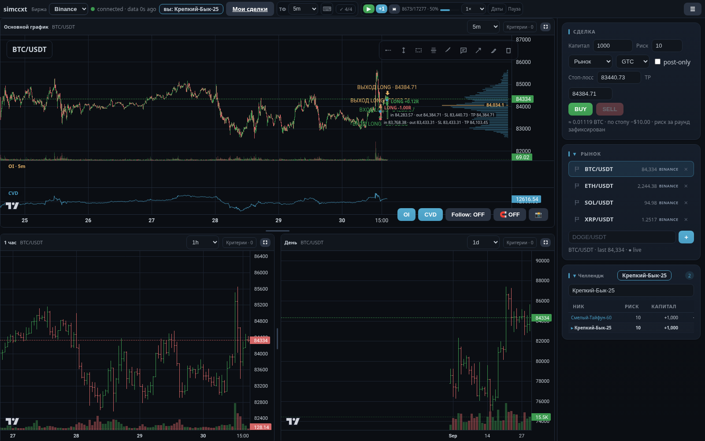
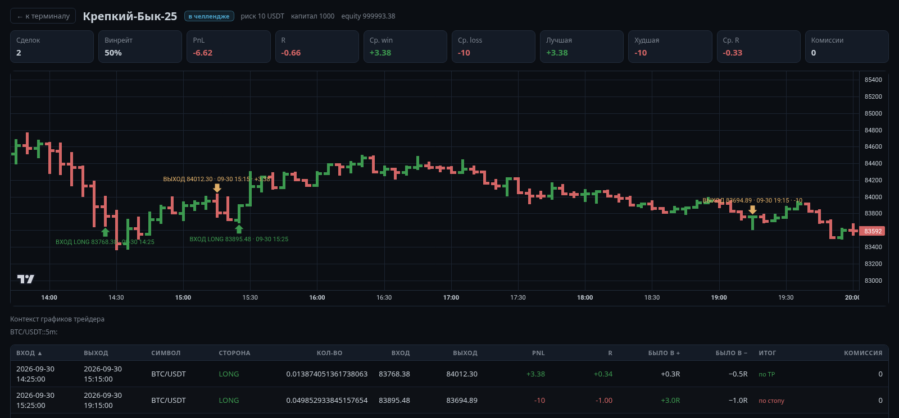
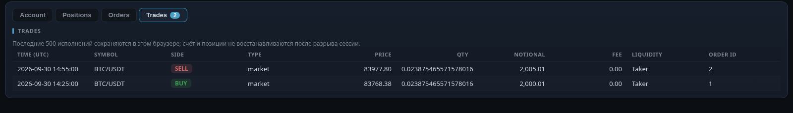

# simccxt

**Virtual cryptocurrency exchange** — a CCXT-compatible exchange simulator.



simccxt is not a backtester. It *is* an exchange: it owns the market, time,
balances, orders, executions, positions, funding, leverage, liquidation and
fees, and speaks the CCXT interface. A strategy cannot tell whether it is
connected to Binance, Bybit, OKX or the simulator.

```rust
use simccxt::Exchange;
let exchange = Exchange::new(); // same calls, same shapes
```

Everything is deterministic: no global state, configurable seeds, reproducible
replays.

## Terminal

A browser terminal on top of the same Rust engine compiled to WebAssembly:
three-panel chart workspace, replay transport, drawings, criteria, a deal
ticket with a mandatory stop, a shared challenge board and a post-trade diary.

- **Chart workspace** — main chart + two independent charts (5m/1h/1d by
  default), draggable split, per-chart timeframe, expand to full screen.
  Lightweight Charts primitives only: no HTML/SVG overlay.
- **OI and CVD** as native sub-panes of the main chart (one clock, one
  crosshair, one zoom), revealed with the replay clock.
- **Volume profile** over the visible range, 64 levels, POC marked.
- **Drawings** — ray, replay barrier, zone, long/short position, ruler.
- **Replay** — `Space` play/pause, `→` one bar, `Home` reset, speed hotkeys;
  the `Даты` popover sets the shared window.
- **Deal ticket** — risk in USDT, always-required stop, BUY/SELL,
  market/limit/stop entries, post-only/IOC/FOK; a reduce-only stop is armed
  after every entry fill and removed with the position.
- **Challenge** — passwordless nick, fixed risk, live board of PnL and R.
- **Diary** — read-only review of every round trip: entry/exit markers, R,
  maximum favourable/adverse excursion (capped at the protective level that
  actually closed the trade), exit verdict and fees.





## Quick start

```bash
# 1. session server: WebSocket 9001 + diary HTTP 9002 (no market data)
cargo run -p simccxt-server -- --symbol BTC/USDT --timeframe 5m

# 2. terminal
cd frontend && bun install && bun run dev   # http://127.0.0.1:5173/
```

Pick a coin, press ▶, click BUY. Candles go from the venue straight to the
browser; the order, position and PnL are computed by the tab's Rust/WASM
engine. The `wasm32-unknown-unknown` target is required for `npm run build`.

## Architecture

```
src/core            Symbol, Order, Trade, Position, Balance, ...
src/clock           controlled time (step/run/seek/pause/reset)
src/market          order book, ticker, funding, open interest, candles
src/storage         in-memory / CSV storage
src/event-bus       synchronous pub/sub (deterministic)
src/exchange        CCXT facade (fetch_*, create_order, cancel_order)
src/broker          order types, settlement, fill log, resting-limit sweep
src/order-engine    matching (market/limit, partial fills, post-only, IOC/FOK)
src/portfolio       positions, cross/isolated margin, liquidation
src/wallet          balances, realized/unrealized PnL, fees, funding
src/wasm            Web Worker adapter for the same Exchange
src/server          sessions + diary/challenge mirror (NO market data)
```

```
venue REST ──▶ browser cache (OPFS + IndexedDB) ──▶ Rust/WASM Exchange (Worker)
                                                        │
server (sessions, challenge, diary) ◀── throttled account/fill mirror
```

- **The server holds no coin data.** Candles and open interest never pass
  through it; every tab downloads 5m bars from the venue, caches them locally
  and aggregates 1h/1d itself.
- **One connection = one isolated session** (account, series, clock). Every
  event carries `to`, so users never see each other's state; disconnect
  destroys the session.
- **Only the series on screen is replayed.** Switching coin or timeframe
  unloads the previous series, so off-screen stops cannot fire.
- **Account and replay clock are in-memory** and die with the page. The last
  500 fills survive a reload in `localStorage`; that cache does not restore
  the account.

## CCXT surface

- `fetch_ohlcv`, `fetch_ticker`, `fetch_order_book`, `fetch_trades`
- `fetch_balance`, `fetch_positions`, `fetch_open_orders`
- `fetch_funding_rate`, `fetch_open_interest`
- `create_order` — market, limit, stop, stop-limit, take-profit,
  take-profit-limit, trailing-stop, post-only, IOC, FOK, reduce-only
- `cancel_order`
- `fetch_fills(symbol=None, limit=None)` — own executions, newest first
- `is_paused()`, and time control: `step`, `run`, `pause`, `resume`, `seek`,
  `reset`

## Replay semantics

- Bars at or before the clock are visible; later bars are revealed one at a
  time. 1h/1d panes re-bucket the same revealed 5m bars, so all panels agree.
- One tick = one 5m bar.
- `reset` puts the clock at the reveal boundary **and pauses**.
- Switching coin or venue opens the new series at its own boundary, paused.
  Switching only the timeframe keeps the clock.

## Market data

- **Only 5m is downloaded**; 1h and 1d are aggregated from it.
- Bars live in OPFS (48 bytes/bar) with an IndexedDB manifest. The same date
  window is never fetched twice; a stale window fetches only trailing bars.
- The watchlist is warmed in the background one coin at a time to respect the
  venue's per-IP rate limit.
- Removing a coin deletes only that coin's cache. Browsers without OPFS fall
  back to memory.
- Open interest is context only, requested on the chart's grid where the venue
  exposes it.
- The Rust listeners bind to `127.0.0.1` only. For remote access use reverse
  SSH + TLS on a VPS; the protocol has no authentication yet.

## Build & test

```bash
cargo test --workspace      # engine + server
cargo clippy --workspace
cargo build --release --workspace

cd frontend
bun run build               # wasm + tsc + vite
bun test                    # pure protocol/math tests
```

## Troubleshooting

| Symptom | Cause |
|---|---|
| `Address already in use` | stale server — find the exact PID and kill it (avoid `pkill -f`) |
| `connecting…` forever | `simccxt-server` is not running; override with `VITE_WS_URL` |
| `data Ns ago` keeps growing | silent link past the 10 s heartbeat; the watchdog reconnects |
| chart stays at one bar | the clock is paused after reset — press ▶ |
| coin takes long to open | not cached yet; the topbar badge shows warm-up progress |
| badge shows ⚠ | some pairs failed (unknown symbol or no venue data) |
| download fails | errors are surfaced; synthetic bars are used only in offline mode |

## License

MIT
