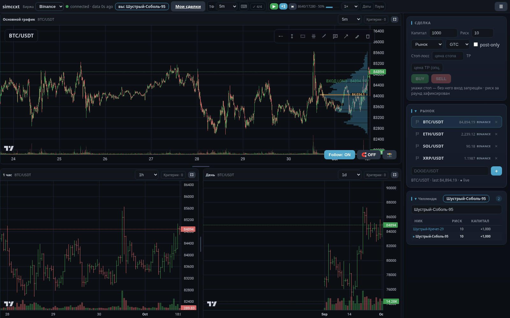
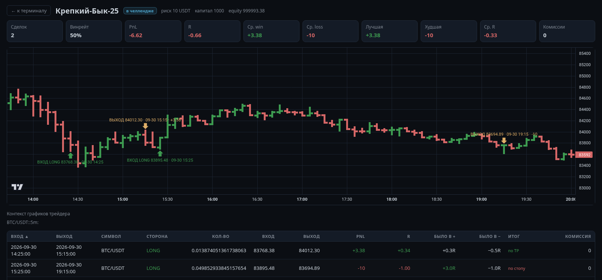
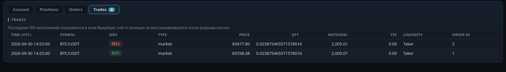

# simccxt

**Virtual cryptocurrency exchange** — a CCXT-compatible exchange simulator.



simccxt is not a backtester. It *is* an exchange: it owns the market, time,
balances, orders, executions, positions, funding, leverage, liquidation and
fees, and speaks the CCXT interface. A strategy cannot tell whether it is
connected to Binance, Bybit, OKX or the simulator.

```rust
use simccxt::Exchange;
let exchange = Exchange::new(); // same calls, same shapes
```

Everything is deterministic: no global state, configurable seeds, reproducible
replays.

## Terminal

A browser terminal on top of the same Rust engine compiled to WebAssembly:
three-panel chart workspace, replay transport, drawings, criteria, a deal
ticket with a mandatory stop, a shared challenge board and a post-trade diary.

- **Chart workspace** — main chart + two independent charts (5m/1h/1d by
  default), draggable split, per-chart timeframe, expand to full screen.
  Lightweight Charts primitives only: no HTML/SVG overlay.
- **Volume profile** over the visible range, 64 levels, POC marked.
- **Drawings** — ray, replay barrier, zone, long/short position, ruler.
- **Replay** — `Space` play/pause, `→` one bar, `Home` reset, speed hotkeys;
  the `Даты` popover sets the shared window.
- **Deal ticket** — risk in USDT, always-required stop, BUY/SELL,
  market/limit/stop entries, post-only/IOC/FOK; a reduce-only stop is armed
  after every entry fill and removed with the position.
- **Challenge** — passwordless nick, fixed risk, live board of PnL and R.
- **Diary** — read-only review of every round trip: entry/exit markers, R,
  maximum favourable/adverse excursion (capped at the protective level that
  actually closed the trade), exit verdict and fees.





## Quick start

One process, one port for the browser: the terminal, the WebSocket and the
diary API. (The server also opens `port + 1` as a local-only alias for the
vite dev flow; the built terminal never uses it.)

Needs Rust (a `rustup` toolchain — the wasm target is installed on demand) and
Node 18+ (a current LTS release).

```bash
cargo build --release -p simccxt-server
cd frontend && npm install && npm run build && cd ..

./target/release/simccxt-server --port 19010
# open http://127.0.0.1:19010/
```

On a VPS add `--host 0.0.0.0` (and keep TLS in front: the protocol has no
authentication yet). `--web-dir` points at another build output if needed.
Open the server's own port (`http://<host>:19010/`), not the vite dev port:
vite is a local development server and its WebSocket/API ports are not part of
the built terminal. A reverse proxy in front of `:19010` works too, as long as
it forwards WebSocket upgrades.

### Publish through a VPS (reverse tunnel)

A reverse SSH tunnel makes a terminal running on your machine reachable on a
VPS without opening an inbound port, running the server there, or changing
anything on the VPS. No address is built into the repo: it comes from the
environment or from `.vps-tunnel.env`, which is gitignored.

```bash
cp scripts/vps-tunnel.env.example .vps-tunnel.env
$EDITOR .vps-tunnel.env              # VPS_HOST=<host or ~/.ssh alias>
ssh-copy-id root@<vps-host>          # once — the script runs in BatchMode

scripts/vps-tunnel.sh                # builds if needed, serves, opens the tunnel
# → http://<VPS_HOST>:<REMOTE_PORT>/

scripts/vps-tunnel.sh --status
scripts/vps-tunnel.sh --stop
```

`VPS_HOST` may be an `~/.ssh/config` alias, so the real address never has to
appear in a command; set `PUBLIC_HOST` to the address you actually open when
the alias differs from it. CLI flags (`--host`, `--user`, `--public-host`,
`--remote-port`, …) override the file. `BIND=0.0.0.0` needs
`GatewayPorts yes` in the VPS `sshd_config` and an open `REMOTE_PORT` in its
firewall. Without it the port binds to the VPS loopback only: set
`BIND=127.0.0.1` and open it through an SSH local forward, which the script
prints. The only thing created on the VPS is the forwarded port — nothing
there is edited.

Pick a coin, press ▶, click BUY. Candles go from the venue straight to the
browser — or through the server if your network blocks the venue. The order,
position and PnL are computed by the tab's Rust/WASM engine. `npm run build` compiles that engine itself — a fresh clone has no
`simccxt_wasm.wasm` until then, and the build fails loudly instead of shipping
a broken page. The `wasm32-unknown-unknown` target is installed by the build
(`rustup target add`) the first time it is needed; set `SIMCCXT_SKIP_RUSTUP=1`
to disable that in CI, and add the wasm standard library manually if your Rust
did not come from rustup.

### Development

```bash
cargo run -p simccxt-server -- --port 9001    # WS :9001 + diary API :9002
cd frontend && npm install && npm run dev     # http://127.0.0.1:5173/
```

`npm run dev` builds the wasm first too. When the page is served by the Rust
server it dials back to its own origin (`--port 19010` included); in the vite
dev flow it falls back to `ws://127.0.0.1:9001` and `http://127.0.0.1:9002`,
and `VITE_WS_URL` / `VITE_API_URL` override them.

## Architecture

```
src/core            Symbol, Order, Trade, Position, Balance, ...
src/clock           controlled time (step/run/seek/pause/reset)
src/market          order book, ticker, funding, candles
src/storage         in-memory / CSV storage
src/event-bus       synchronous pub/sub (deterministic)
src/exchange        CCXT facade (fetch_*, create_order, cancel_order)
src/broker          order types, settlement, fill log, resting-limit sweep
src/order-engine    matching (market/limit, partial fills, post-only, IOC/FOK)
src/portfolio       positions, cross/isolated margin, liquidation
src/wallet          balances, realized/unrealized PnL, fees, funding
src/wasm            Web Worker adapter for the same Exchange
src/server          sessions + diary/challenge mirror (NO market data)
```

```
venue REST ──▶ browser cache (OPFS + IndexedDB) ──▶ Rust/WASM Exchange (Worker)
                                                        │
server (sessions, challenge, diary) ◀── throttled account/fill mirror
```

- **The server holds no coin data.** Every tab downloads 5m bars from the
  venue, caches them locally and aggregates 1h/1d itself. The server only
  forwards a single page when a browser cannot reach the venue at all (see
  [Market data](#market-data)); nothing is stored.
- **One connection = one isolated session** (account, series, clock). Every
  event carries `to`, so users never see each other's state; disconnect
  destroys the session.
- **Only the series on screen is replayed.** Switching coin or timeframe
  unloads the previous series, so off-screen stops cannot fire.
- **Account and replay clock are in-memory** and die with the page. The last
  500 fills survive a reload in `localStorage`; that cache does not restore
  the account.

## CCXT surface

- `fetch_ohlcv`, `fetch_ticker`, `fetch_order_book`, `fetch_trades`
- `fetch_balance`, `fetch_positions`, `fetch_open_orders`
- `fetch_funding_rate`
- `create_order` — market, limit, stop, stop-limit, take-profit,
  take-profit-limit, trailing-stop, post-only, IOC, FOK, reduce-only
- `cancel_order`
- `fetch_fills(symbol=None, limit=None)` — own executions, newest first
- `is_paused()`, and time control: `step`, `run`, `pause`, `resume`, `seek`,
  `reset`

## Replay semantics

- Bars at or before the clock are visible; later bars are revealed one at a
  time. 1h/1d panes re-bucket the same revealed 5m bars, so all panels agree.
- One tick = one 5m bar.
- `reset` puts the clock at the reveal boundary **and pauses**.
- Switching coin or venue opens the new series at its own boundary, paused.
  Switching only the timeframe keeps the clock.

## Market data

- **Only 5m is downloaded**; 1h and 1d are aggregated from it.
- Bars live in OPFS (48 bytes/bar) with an IndexedDB manifest. The same date
  window is never fetched twice; a stale window fetches only trailing bars.
- The watchlist is warmed in the background one coin at a time to respect the
  venue's per-IP rate limit.
- **Fallback when the venue is unreachable.** Some networks (region/IP blocks,
  corporate proxies, CORS) cannot reach `api.binance.com` from the browser.
  The direct request is always tried first; only if it fails, the page asks its
  own server for that one page (`/api/market/klines`, `/api/market/ticker`) and
  the server forwards it to the venue. The server stores nothing, and the venue
  is an enum — a request can never point it at an arbitrary URL. Rate limits
  (429/418) are never rerouted, because the server shares the same venue
  budget.
- Removing a coin deletes only that coin's cache. Browsers without OPFS fall
  back to memory.
- The server binds to `127.0.0.1` by default. For remote access run it with
  `--host 0.0.0.0` and put TLS in front; the protocol has no authentication
  yet.

## Build & test

```bash
cargo test --workspace      # engine + server
cargo clippy --workspace
cargo build --release --workspace

cd frontend
npm run build               # wasm + tsc + vite  (bun works too)
npm test                    # pure protocol/math tests
```

## Troubleshooting

| Symptom | Cause |
|---|---|
| `Address already in use` | stale server — find the exact PID and kill it (avoid `pkill -f`) |
| `expected magic word 00 61 73 6d, found 3c 21 64 6f 63` | `simccxt_wasm.wasm` was not built (the server answered with index.html). Run `cd frontend && npm run build:wasm` and reload |
| `can't find crate for core` / `std` | the `wasm32-unknown-unknown` target is missing; `rustup target add wasm32-unknown-unknown` (the build does this itself when rustup is present) |
| `connecting…` forever | `simccxt-server` is not running, or the page is on vite dev without :9001; override with `VITE_WS_URL` |
| `data Ns ago` keeps growing | silent link past the 10 s heartbeat; the watchdog reconnects |
| chart stays at one bar | the clock is paused after reset — press ▶ |
| coin takes long to open | not cached yet; the topbar badge shows warm-up progress |
| badge shows ⚠ | some pairs failed (unknown symbol or no venue data) |
| `не удалось загрузить данные с биржи` / `нет связи с …` | this network cannot reach the venue (region/IP block, proxy, CORS). The page retries the same data through its server; if that also fails, check the server's outbound access to the venue |
| download fails | errors are surfaced; synthetic bars are used only in offline mode |
| page says «терминал ещё не собран» | `frontend/dist` is missing — `cd frontend && npm run build` |
| tunnel opens but `http://<host>:<port>/` times out | sshd bound the `-R` port to loopback (`GatewayPorts no`) or a firewall blocks it — set `BIND=127.0.0.1` and use `ssh -L`, or enable `GatewayPorts yes` |
| `scripts/vps-tunnel.sh` asks for nothing and exits with `Permission denied (publickey)` | key auth is not set up — `ssh-copy-id "$VPS_USER@$VPS_HOST"`, or export `SSH_ASKPASS` (the script honours it) |

## License

MIT
